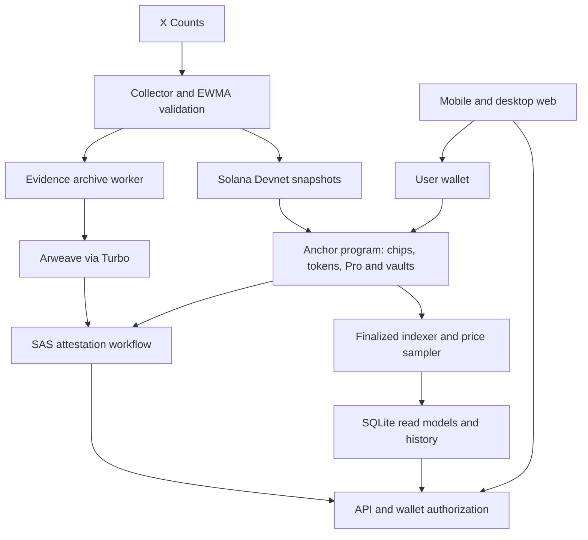

# Ante Up

**Call it. Ante up. Prove it.**

Ante Up is a mobile-first app for taking a view on internet attention. Place a no-money chip, follow how attention changes, and take back the chip to record the result. Optional Devnet trading connects eligible markets to keyword tokens, leveraged positions and liquidity vaults.

**[Open the app](https://ante-up.fun)** · **Solana Devnet MVP** · **Updated October 13, 2026**

All financial flows use test assets. This is an experimental implementation, not a mainnet product or a claim of proven economic safety.

## Try it

1. Open **Explore** to browse charts and subjects without a wallet. The R2 catalog combines the existing Devnet market with 15 recognizable subjects whose histories remain explicitly synthetic. A real title or image does not imply a live feed or executable pool.
2. Check each item's source and action state. At the last deployment check, collected data covered one approved keyword: `solana`. Sample history and example activity stay separate from Devnet records and rankings.
3. Connect a Devnet wallet. Desktop Phantom, Android Phantom's in-app browser, and Seeker Chrome with Seed Vault Wallet have completed real-device flows on an earlier UI release.
4. Use the in-app **Faucet** for tUSD. Devnet SOL for transaction fees is separate. Faucet and new-entry availability depend on operator limits and data readiness.
5. **Place chip** on an eligible Devnet market, watch its attention reference, then **Take back chip** to finalize the result. A wallet can hold up to three active chips, with one per market. Attention change is not a cash return.

The unified R2 catalog and Docs are integrated in this checkout. This does not update the deployed site, which may still show the older Live/Demo navigation until a verified release. The latest consumer UI needs another real-wallet regression pass. A closed chip record and its completed evidence/SAS attestation are separate states; archival and attestation may finish later. Read the [product Docs](docs/product/README.md) for the source articles.

## What is implemented

| Area | Current implementation |
| --- | --- |
| Consumer app | English mobile web, unified Explore, price and attention charts, participation markers, public profiles, leaderboard, authenticated notes and in-app Docs |
| Chips | Wallet-authorized no-money entry and close, on-chain records, attention result and evidence status |
| Test-asset trading | Faucet, registration, bonding-curve buy/sell, graduation, spot exchange, Pro long/short and LP participation |
| Data | X Counts collector, validation, EWMA calculation and Solana snapshot publishing on a five-minute cycle |
| Charts | Finalized-chain price samples every five minutes; visible observed Devnet charts refresh from the API every 60 seconds |
| Evidence | Raw inputs and calculation evidence archived through Arweave/Turbo; Solana records and SAS attestations link results to evidence |
| Operations | API, indexer and bounded workers; provider budgets, stale-data handling and restart recovery |

The MVP uses a custom Anchor program and a collateral-reserving vault settlement model. It does **not** implement InfinityPools-style borrowing and reconstruction of external AMM liquidity. Maximum test leverage is 5×; admission and reserved liability limits still apply.

## Architecture



The MVP has one operator-controlled data publisher. Recording a statement on-chain does not independently verify the truth of the source data. Profile notes are not SAS attestations. Sample and observed Devnet data remain distinguishable.

## Repository layout

| Path | Responsibility |
| --- | --- |
| `apps/web` | React/Vite app, wallet integration, charts and consumer screens |
| `programs/ante_up`, `programs/ante_up_math` | Anchor program and shared Rust calculations |
| `clients/chain` | IDL, generated client and transaction adapters |
| `contracts` | Shared contracts, reference calculations and test vectors |
| `services/data` | Counts collection, EWMA, validation and publication |
| `services/api` | Read API, wallet sessions, transaction preparation and notes |
| `services/indexer` | Finalized-chain projections and price history |
| `services/evidence` | Evidence preparation, archive verification and SAS integration |
| `services/keeper` | Graduation and settlement automation code |
| `scripts`, `tests`, `deploy` | Local tools, integration tests and container configuration |

## Run a local preview

Use **Node.js 24+**, npm and Git. Linux is the reference integration environment. Each module has its own manifest and lockfile; there is no root npm workspace.

From the repository root:

```sh
node scripts/install-dependencies.mjs --plan
node scripts/install-dependencies.mjs
npm --prefix clients/chain run build
node scripts/doctor.mjs
node scripts/preview-integration.mjs
```

Open **http://127.0.0.1:5194**. This starts a fixture API and Vite preview without provider credentials, wallet transactions or paid collection. Stop it with Ctrl+C. Native chain tooling is reported separately by the doctor; a successful dependency check does not establish deployed readiness.

## Run checks

```sh
node scripts/verify-integration.mjs
```

This runs module type checks, reference and integration tests, web tests and the web build. Native SBF/LiteSVM checks require the documented program build and toolchain; a skipped check is not a passed chain test.

For the separate native-tooling inventory, run `node scripts/doctor.mjs --require-chain`.

See [local runtime](docs/implementation/LOCAL_RUNTIME.md), [SDK setup](docs/implementation/SDK_IMPLEMENTATION.md) and [financial runtime](docs/implementation/FINANCIAL_RUNTIME.md) for module-specific requirements.

## Connect live services

The local preview needs no API keys. Live operation additionally needs:

- X API access for the configured Counts queries and budget.
- Solana Devnet RPC access and separately provisioned operator signing keys.
- An Arweave/Turbo upload wallet and credits where required.
- SAS configuration, persistent storage, and an HTTPS endpoint for mobile wallets.

Use module `.env.example` files as templates. Keep actual credentials, wallet key files and runtime databases outside version control. `VITE_*` variables are public browser-build inputs and must never contain private credentials. Starting the web app does not start collectors or fund wallets.

`node scripts/serve-web.mjs` serves the built app on loopback port 8080 and proxies `/api/` to `API_ORIGIN` (default `http://127.0.0.1:8787`). Run the API separately. The clean container build is `deploy/Dockerfile`; optional release overlays can depend on pre-existing operator images.

## Verification status

Completed checks on October 13, 2026; these are not continuous service guarantees:

| Check | Result and boundary |
| --- | --- |
| Linux integration regression | 210 passed, 2 native checks skipped in that environment |
| Web regression | 40/40 passed, including HTTP integration |
| Consumer browser QA | 38 checks at desktop and mobile viewport sizes, using a local mock API |
| Public deployment | Seven routes and JS/CSS/favicon matched the release; real API cross-view checks passed |
| Real wallets | Earlier UI completed PC/Android Phantom and Seeker chip flows; Seeker curve buy/sell also finalized |
| Financial program | Synthetic Devnet market exercised curve, graduation, spot, LP and 5× long/short flows |
| Evidence | Real Arweave storage and SAS issuance verified for test records; pending records may still be incomplete |

Deployed consumer source: `8023388`. Integrated development baseline: `e66e708`. These identify the original development history and may not resolve in a separately published snapshot repository.

### Remaining work

- Integrate the R2 catalog, activity, Docs routes, and navigation; then repeat wallet approval, cancellation and response-loss recovery on the latest UI and verify an owning wallet's note write.
- Integrate remaining proof-worker, keeper and operational follow-up changes from separate development branches.
- Validate broader live source coverage, economic assumptions and production security before considering real assets.

## Design documentation

For app guidance, start with [product Docs](docs/product/start.md). For implementation, read the [MVP specification](docs/implementation/MVP_SPEC.md), [contract revision 0.2](docs/implementation/CONTRACT_V02.md) and sources. The older [product vision](docs/PRODUCT_VISION.md), [context](docs/CONTEXT.md), [PRD](docs/PRD.md) and [glossary](docs/GLOSSARY.md) preserve design history; their October 11 technical TBDs are superseded by later implementation decisions. They are not current deployment reports.

## Publication and license

This public repository began as a snapshot of the development project. Its initial publication commit is not the date all development began. Private operational records and credentials are excluded from the publication package.

Original source code and documentation are licensed under the [MIT License](LICENSE).
Brand images are excluded; third-party components retain their own licenses. See
[licensing scope](LICENSING.md).

Public repository: [unknown2733/ante-up-app](https://github.com/unknown2733/ante-up-app),
owned by the shared GitHub organization. See [publication provenance](PUBLICATION.md)
for the development baseline and publication scope.
