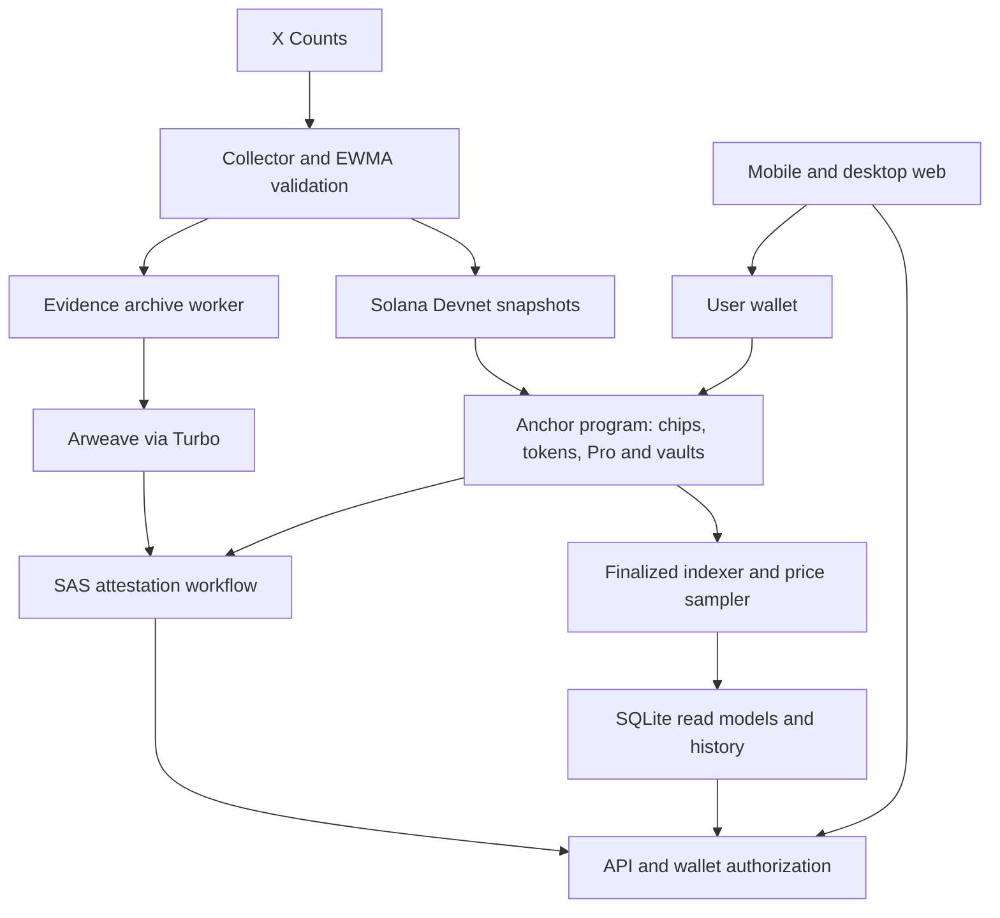

# Ante Up

**Call it. Ante up. Prove it.**

Ante Up is a mobile-first app for taking a view on internet attention. Place a no-money chip, follow how attention changes, and take back the chip to record the result. Optional Devnet trading connects eligible markets to keyword tokens, leveraged positions and liquidity vaults.

**[Open the app](https://ante-up.fun)** · **Solana Devnet MVP** · **Updated October 17, 2026**

All financial flows use test assets. This is an experimental implementation, not a mainnet product or a claim of proven economic safety.

## Try it

1. Open **Explore** to browse charts and subjects without a wallet. The catalog combines observed Devnet markets with read-only **Preview** subjects backed by fetched public reference data or official metadata and artwork.
2. Check each item's source, metric, capture date, and action state. The `solana` and `tariff` keyword markets have observed X Counts feeds; other catalog subjects remain references unless marked tradable. Public snapshots show YouTube views, X post likes, and dated third-party Spotify stream reports. Reference subjects do not feed settlement. Profiles, activity, and rankings use Devnet records.
3. Connect a Devnet wallet. Desktop Phantom, Android Phantom's in-app browser, and Seeker Chrome with Seed Vault Wallet have completed real-device flows on an earlier UI release.
4. Open the in-app **Faucet** to check Devnet SOL for network fees, then request tUSD. A dedicated capped Devnet funder currently offers eligible wallets 0.02 test SOL once per 24 hours, with a 0.4 SOL daily and 0.8 SOL cumulative service limit. The page also links to the official Devnet faucet. Availability depends on the funder balance and operator limits.
5. **Place chip** on an eligible Devnet market, watch its attention reference, then **Take back chip** to finalize the result. A wallet can hold up to three active chips, with one per market. Attention change is not a cash return.

This source revision replaces synthetic catalog histories and fictional profiles with public reference data and actual Devnet records. Reference subjects have no token quotes, chips, trades, PnL, or attestations. The visitor SOL path was deployed and verified with a fresh Devnet wallet, including finalization and duplicate-request handling. The latest consumer UI still needs another physical-wallet regression pass. A closed chip record and its completed evidence/SAS attestation are separate states; archival and attestation may finish later. Read the [in-app Docs](https://ante-up.fun/docs) or the [source articles](docs/product/README.md).

## What is implemented

| Area | Current implementation |
| --- | --- |
| Consumer app | English mobile web, unified Explore, price and attention charts, participation markers, public profiles, leaderboard, authenticated notes and in-app Docs |
| Chips | Wallet-authorized no-money entry and close, on-chain records, attention result and evidence status; finalized result cards with PNG download, mobile file sharing and public record links |
| Test-asset trading | Faucet, registration, bonding-curve buy/sell, graduation, spot exchange, Pro long/short and LP participation |
| Data | X Counts collector, validation, EWMA calculation and Solana snapshot publishing on a five-minute cycle |
| Charts | Explore sparklines and market-detail charts show actual price or activity observations, with metric, period and first-to-last change; missing history stays explicit. Finalized-chain price samples every five minutes; visible observed Devnet detail charts refresh every 60 seconds |
| Reference catalog | Twelve actual subjects: five YouTube videos, three X posts, four Spotify tracks; five dated histories (61 observations), seven single snapshots, original media and source links. Nine insufficient-history subjects also have explicitly labeled display-only illustrative trends; original observations remain separate. Source implementation now accepts verified append-only observations through a read-only API, pending provider collectors and deployment |
| Evidence | Raw inputs and calculation evidence archived through Arweave/Turbo; Solana records and SAS attestations link results to evidence |
| Operations | API, indexer and bounded workers; provider budgets, stale-data handling and restart recovery |

The Devnet program currently permits up to 10 graduated markets and 100,000 test tUSD of cumulative protocol contributions, capped at 10,000 test tUSD per market. Graduation still requires actual protocol-held tUSD, valid observed data, a filled curve, and the vault reserve checks. Paid X collection is activated separately by the operator; these limits do not imply that every registered market has a live data feed.

The MVP uses a custom Anchor program and a collateral-reserving vault settlement model. It does **not** implement InfinityPools-style borrowing and reconstruction of external AMM liquidity. Maximum test leverage is 5×; admission and reserved liability limits still apply.

## Architecture



The MVP has one operator-controlled data publisher. Recording a statement on-chain does not independently verify the truth of the source data. Profile notes are not SAS attestations. Public reference data do not feed chip results or settlement. Synthetic fixtures are reserved for development and tests.

## Repository layout

| Path | Responsibility |
| --- | --- |
| `apps/web` | React/Vite app, wallet integration, charts and consumer screens |
| `programs/ante_up`, `programs/ante_up_math` | Anchor program and shared Rust calculations |
| `clients/chain` | IDL, generated client and transaction adapters |
| `contracts` | Shared contracts, reference calculations and test vectors |
| `services/data` | Counts collection, EWMA, validation and publication |
| `services/api` | Read API, wallet sessions, transaction preparation and notes |
| `services/indexer` | Finalized-chain projections and price history |
| `services/evidence` | Evidence preparation, archive verification and SAS integration |
| `services/keeper` | Graduation and settlement automation code |
| `scripts`, `tests`, `deploy` | Local tools, integration tests and container configuration |

## Run a local preview

Use **Node.js 24+**, npm and Git. Linux is the reference integration environment. Each module has its own manifest and lockfile; there is no root npm workspace.

From the repository root:

```sh
node scripts/install-dependencies.mjs --plan
node scripts/install-dependencies.mjs
npm --prefix clients/chain run build
node scripts/doctor.mjs
node scripts/preview-integration.mjs
```

Open **http://127.0.0.1:5194**. This starts a fixture API and Vite preview without provider credentials, wallet transactions or paid collection. Stop it with Ctrl+C. Native chain tooling is reported separately by the doctor; a successful dependency check does not establish deployed readiness.

## Run checks

```sh
node scripts/verify-integration.mjs
```

This runs module type checks, reference and integration tests, web tests and the web build. Native SBF/LiteSVM checks require the documented program build and toolchain; a skipped check is not a passed chain test.

For the separate native-tooling inventory, run `node scripts/doctor.mjs --require-chain`.

See [development setup](docs/DEVELOPMENT.md) for local requirements and architecture boundaries.

## Connect live services

The local preview needs no API keys. Live operation additionally needs:

- X API access for the configured Counts queries and budget.
- Solana Devnet RPC access and separately provisioned operator signing keys.
- An optional separately funded visitor SOL keypair and explicit caps to enable in-app network-fee grants; this feature stays disabled by default. See `deploy/compose.visitor-sol.yml`.
- An Arweave/Turbo upload wallet and credits where required.
- SAS configuration, persistent storage, and an HTTPS endpoint for mobile wallets.

Use module `.env.example` files as templates. Keep actual credentials, wallet key files and runtime databases outside version control. `VITE_*` variables are public browser-build inputs and must never contain private credentials. Starting the web app does not start collectors or fund wallets.

`node scripts/serve-web.mjs` serves the built app on loopback port 8080 and proxies `/api/` to `API_ORIGIN` (default `http://127.0.0.1:8787`). Run the API separately. The clean container build is `deploy/Dockerfile`; optional release overlays can depend on pre-existing operator images.

Opt-in Compose profiles and the scripts under `scripts/ops/` provide backup and monitoring primitives. Operator-specific configuration and run records are kept outside this repository.

## Devnet status

As of October 18, 2026, the `solana` and `tariff` markets have graduated from
their curves on Devnet with operator-provided test capital. On `solana`, small LP
deposit/withdrawal, spot buy/sell, and 5× Pro long/short open/close/claim
transactions were finalized against its observed X Counts index. On `tariff`,
the initial LP window, indexed spot availability, and one 5× Pro long opening
were verified. That position remains open for the first normal weekly maturity.
These checks do not yet establish normal maturity settlement, economic safety,
or organic user demand.
Reference videos and posts have separate observed metrics; they are not
keyword-market settlement inputs.

Earlier PC, Android Phantom, and Seeker flows completed with real Devnet
wallets. The latest UI still needs a full physical-wallet regression pass.
The Arweave/SAS path has issued proofs for test records, while additional
records can remain pending. Run the checks above for this checkout; historical
test totals are not a substitute for a current run.

### Remaining work

- Repeat wallet approval, cancellation and response-loss recovery on the latest UI and verify an owning wallet's note write.
- Expand evidence processing beyond the current bounded record allowlist and verify the remaining archive/SAS backlog. The worker reuses signed upload receipts and has a total spend cap; a healthy worker does not mean every record has a proof.
- Complete a normal weekly maturity using the observed `solana` feed, then verify settlement acceptance and the next LP window.
- Validate broader live source coverage, economic assumptions and production security before considering real assets.

## Documentation

For the user experience, read the [product Docs](docs/product/start.md). For
setup and code boundaries, read the [development guide](docs/DEVELOPMENT.md).
Shared DTOs and financial rules are defined by `contracts/`, the program,
and their tests. Internal decisions, handoffs, deployment journals, and raw
operator evidence are intentionally outside the public source tree.

## Publication and license

This public repository began as a snapshot of the development project. Its
initial publication commit is not the date development began. Keep private
operator state and credentials outside the repository.

Original source code and documentation are licensed under the [MIT License](LICENSE).
Brand images are excluded; third-party components retain their own licenses. See
[licensing scope](LICENSING.md).

Public repository: [unknown2733/ante-up-app](https://github.com/unknown2733/ante-up-app),
owned by the shared GitHub organization.
