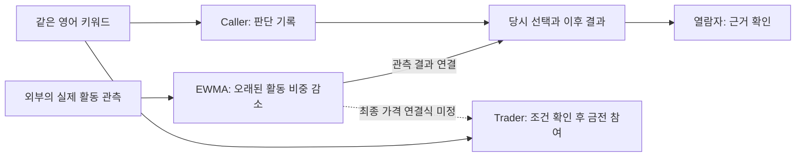
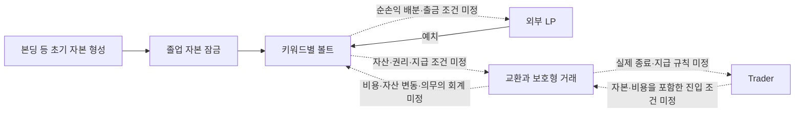

# 아이디어의 맥락과 사용자 예시

2026-10-11 기준 처음 합류한 팀원을 위한 설명이다. 기존 프로젝트 기록을 재구성했으며 원본 전체와 개인 발언 원문은 포함하지 않았다. 아래 가상 사례는 이해를 위한 예시이고 새 기능·경제 계약의 채택이 아니다.

블록체인·거래 개념이 생소하다면 [기초 설명](BLOCKCHAIN_BASICS.md)을 함께 읽는다. 사용자 사례부터 이해하고, 아래 경제 흐름에 등장하는 본딩커브·풀·LP·보호형 계약을 필요한 순간에 확인하면 된다.

## 1. 어떤 욕구에서 시작했는가

좋아하는 크리에이터나 밈이 유명해지기 전부터 봤던 사람이 나중에 “나는 먼저 알아봤어”라고 말한다. 출발점은 그 말을 성공 이후에 하는 데서 그치지 않고, **그때 무엇을 언제 선택했는지 남기고 이후 결과와 함께 보여주는 경험**이다. 그 판단에 돈을 걸 수 있는 경로에도 관심을 두었다.

제품에는 따라서 두 가지 관계가 함께 있다. 하나는 판단 시점·대상·외부 관심 변화가 남는 기록이고, 다른 하나는 실제 진입·종료·비용에 따라 계산되는 금전 결과다. 둘을 같은 성과로 취급하면 사용자가 무엇을 잘했는지 설명하기 어렵다.

현재 첫 사용자는 X·밈·트렌드를 먼저 찾는 온체인 참여자로 선택됐다. 이 선택이 실제 시장 수요를 검증한 결과는 아니다. 기록과 금전 참여 중 어느 행동이 반복 이용을 만드는지도 관찰해야 한다.

## 2. 아이디어가 발전한 순서

이전 모델을 외우기보다 무엇이 지금 남았는지를 읽는다. 전체 과거 논의·조사 문서는 공유 범위 밖이다.

| 단계 | 검토했던 질문 | 현재에 남긴 것 또는 달라진 것 |
|---|---|---|
| 크리에이터 조기 발견·토큰 | 먼저 알아본 사람이 이력과 이후 가격 상승에 참여할 수 있는가? | 조기 판단을 남기고 선택적으로 자본을 참여시키는 욕구 |
| 멤버십·일반 성장 거래 비교 | 대상이 앱 안에서 지속적으로 혜택을 만들어야 하는가? 어떤 성과를 거래하는가? | 외부 활동을 관측한다는 방향. 단순 토큰 가격과 외부 관심은 구분 |
| 미래 협찬권 | 크리에이터의 미래 광고 자리를 확보·양도하면 실수요와 연결되는가? | 이전 모델로 보존. 현재 MVP에 협찬 납품·광고주·행사 권리를 넣지 않음 |
| 관심 선택·기록 제품 | 대상에 칩을 걸고 원하는 순간 거두며 당시 선택을 보여줄 수 있는가? | 현재의 발견·참여·관찰·종료·기록 경험 |
| 기록과 금융 경로 구분 | 소비자 기록 경험과 거래·자본 공급을 같은 제품에서 어떻게 연결할까? | 기본/Pro 분리, Caller·Trader·LP의 다른 결과와 부담 |
| 실제 자본·지표 연결 | 외부 관심 변화가 실제 교환·보호 지급과 어떻게 연결되는가? | 풀 기반 보호형 방향·키워드별 볼트. 지급·담보·회계의 구체식은 미정 |
| 지표 선택 구체화 | 과거 활동의 이탈만으로 가격이 움직이는 문제를 어떻게 줄일까? | 무가중 28일 기준에서 시간 가중·EWMA 방향으로 변경. 최종 가격식은 재설계 |

‘새 모델로 이동했다’는 설명을 이전 프로젝트·원본·판단 전체의 폐기로 해석하지 않는다. 현재 적용되는 선택과 부분 변경은 [결정사항](DECISIONS.md)에 정리했다.

## 3. 한 사용자로 따라가는 예시

**가상의 밈 `moonwalk latte`를 사용하는 설명용 상황**이다. 실제 측정 소스·수치·제품 화면·성과가 아니다. 요일 역시 이야기의 순서이며 고정 계약 기간을 뜻하지 않는다.

| 장면 | 사용자가 하는 일 | 무엇을 구분해서 이해할까? |
|---|---|---|
| 월요일, 처음 발견 | “이 밈이 더 퍼질 것 같다”고 생각하고 키워드를 검색 | 첫 MVP의 대상은 영어 키워드. 밈 게시물·계정의 모든 데이터를 지원하는 것은 아님 |
| 판단 기록 | 해당 키워드에 무료 칩으로 참여하고 당시 대상·시점·관측 근거를 남기는 경험 | 무료 수량·점수·정확한 기록 필드는 미정. 당시 기록을 남기는 방향은 채택 |
| 수요일, 별도 금전 참여 | 관심 변화를 계속 본 뒤 금전 칩 또는 Pro 경로의 조건을 확인 | 월요일 판단 기록과 수요일의 실제 금전 진입은 별도. 권리·비용·자금 환경은 명세 필요 |
| 그 이후, 관찰 | 관심이 더 커졌지만 논란도 생겼다는 상황을 본다 | 좋아한다·주목받는다·판단이 모두 옳았다·이익이 났다는 말은 각각 다름 |
| 원하는 순간 종료 | 기록 또는 포지션을 종료해 결과를 확인한다 | 기록 성과와 비용 포함 금전 손익을 나눔. 포지션 부분 종료는 MVP에서 제외 |
| 공유와 확인 | 친구가 당시 키워드·판단 시점·후속 관측과 참여 결과를 대조 | 기록 확인은 미래 성공·원문 진실성·영구 보존을 자동 보장하지 않음 |

이 이야기에는 고정 기한이나 “언제까지 몇 건이 된다”는 이벤트 적중 조건이 없다. 사용자가 원하는 순간 종료하는 경험과 내부 보호 계약의 기간·갱신·실패 처리는 별도로 설계한다.

### 같은 키워드에 다른 사람이 참여한다면

Caller는 당시 판단을 남길 수 있는 이력과 참여 경험을 원한다. Trader는 앞으로의 관심 변화에 금전 노출을 원하며 방향·진입·종료·비용에 따라 다른 결과를 얻는다. LP는 이 시장의 거래를 뒷받침하는 자본을 공급하고 설계에 따른 순손익에 참여한다. 세 경로는 같은 사람도 선택할 수 있지만 권리와 위험은 같지 않다.

LP의 존재가 Caller의 무료 기록을 금전 이익으로 바꾸는 것은 아니다. 최초 기록 시점으로 나중 거래의 수익을 소급하지도 않는다. `Call it. Ante up. Prove it.`은 첫 사용자의 흐름이며 세 역할의 이름을 하나씩 대신하지 않는다.

## 4. 데이터와 돈이 연결되는 방향

용어의 입구: [본딩커브](BLOCKCHAIN_BASICS.md#2-본딩커브--초기-가격을-규칙으로-정하기) · [풀과 AMM](BLOCKCHAIN_BASICS.md#3-풀과-amm--모아-둔-자산으로-자동-교환하기) · [LP](BLOCKCHAIN_BASICS.md#4-lp--자동-교환소에-자산을-공급하는-사람) · [보호형 거래](BLOCKCHAIN_BASICS.md#5-보호형-거래--무엇을-보호하는지-계약으로-정하기).

외부 활동 데이터를 관측하는 것은 ‘관심이 어떻게 변했는가’를 계산하기 위한 입력이다. 데이터 자체에서 지급할 돈이 생기지는 않는다. 거래와 지급은 실제 자본·권리·체결·비용을 함께 설계해야 한다.

### 한눈에 보는 사용자와 데이터

**같은 키워드가 기록과 거래의 공통 대상**이다. Caller는 판단을 남기는 사용자, Trader는 금전으로 참여하는 사용자, 열람자는 공유된 기록을 확인하는 사람이다. 한 사람이 여러 경로를 이용할 수 있다.

실선은 현재 제품 방향의 관계이고, 점선은 연결 방식의 구체화가 남은 관계다. 모두 설계 설명이며 구현 완료를 표시하지 않는다. 기록 성과의 점수식도 미정이다. EWMA는 데이터를 정리하는 방법이므로, 그래프의 화살표만으로 거래가격이나 지급액이 결정되지는 않는다.

가상의 `moonwalk latte`에서 월요일 판단 기록과 수요일 금전 진입은 같은 키워드를 보지만 시점과 결과가 다르다. 친구가 월요일 기록을 확인한다고 수요일 거래의 수익을 보장하거나 대신 지급하는 관계도 아니다.

### 한눈에 보는 자본과 거래

**볼트는 시장 자산과 지급 의무를 관리하는 구조, LP는 여기에 자본을 공급하는 참여자**다. ‘졸업’은 초기 자본 형성 단계에서 다음 거래 단계로 넘어가는 전환을 뜻한다.

초기 잠금 자본과 외부 LP 예치 자본은 같은 볼트에 참여하는 방향이지만 회수 권리는 다르게 설계한다. 거래자의 결과는 볼트 순손익과 관계가 있으나, 모든 손익을 볼트가 현금 차액으로 직접 지급하는 계약으로 정한 것은 아니다. 프로토콜 보상도 별도로 명시할 규칙이 필요하다.

**등록비는 키워드를 만드는 비용, 초기 자본은 거래를 뒷받침할 자본**이다. 등록비의 귀속은 미정이며 위 자본 형성에 자동 합쳐지는 것으로 그리지 않았다. 무료 판단 기록은 LP 예치나 금전 진입 없이 이용하는 별도 경로다. 이 관계도는 읽기용 지도이며 전체 자산 이동·담보·회계 명세가 아니다.

| 흐름 | 채택된 방향 | 아직 닫히지 않은 계약 |
|---|---|---|
| 대상 생성 | 비용 기반 키워드 자유 등록 | 등록비 금액·결제·귀속·데이터가 없는 대상 |
| 초기 자본 형성 | 본딩커브·졸업을 거쳐 볼트 기본자본을 잠그는 방향 | 커브·초기 가격/물량·졸업 조건·전환 |
| 추가 자본 | 외부 LP 예치 참여 | 지분 평가·손실 순위·출금·배분 |
| 외부 관측 | 실제 활동·EWMA 방향 | 소스·단위·이력·빈도·가중치·정정 |
| 거래와 지급 | 지수 연동 교환과 풀 기반 보호형 거래 | 가격 연결·LP 자산/복구 권리·양방향 지급식·담보·한도·비용 |

등록 → 자본 형성 → 거래 개방은 이해를 위한 단계 설명이다. 등록비만 내면 충분한 담보 없이 즉시 보호형 거래가 열리거나 등록자에게 시장 수익권이 자동 생기는 구조는 채택되지 않았다.

표시하는 관심 지표, 가격 기준, 실제 견적, 종료 지급액은 별개다. ‘관심이 늘면 언제나 이익’, ‘LP는 고정 이자를 받는다’, ‘보호형이면 손실/청산/비용이 없다’고 설명할 근거는 현재 없다. 정확한 보호 대상·제외 비용·지급 책임이 필요한 이유는 이 권리들을 정의하기 위해서다.

## 5. 왜 이런 선택을 했는가

아래는 기존 결정의 이유를 팀원이 이해할 수 있도록 풀어 쓴 설명이다. 실제 우월성·성과 검증을 주장하는 내용은 아니다.

| 선택 | 설명할 수 있는 이유 | 남은 검증 |
|---|---|---|
| 기본/Pro 분리 | 단순한 칩·기록 경험과 전문적인 거래/자본 공급에 필요한 정보·조작을 구분 | 기본 금전 칩·Pro 계약 경계, 모드 전환 |
| 영어 키워드 MVP | 첫 대상 범위를 좁히고 향후 언어·계정·콘텐츠 확장 여지를 유지 | 실제 데이터와 비용, 정규화/중복 |
| 풀 기반 보호형 우선 | 사용자에게 사건·목표값·만기를 매번 설정시키지 않으면서 내부 권리·비용·종료를 설계하는 계열을 우선 검토 | 특정 모델의 Solana 구현·LP 회계·지급·실패 처리 |
| 키워드별 볼트 | 초기 시장 자본을 유지하고 교환·보호에 쓰며 외부 자본 참여도 받는 방향 | 잠금·손실 순위·출금·배분·위험 격리 |
| EWMA | 오래된 활동을 점차 덜 반영해 특정 날짜에 과거 활동이 한꺼번에 제외되는 경계를 줄이는 방향 | 저활동 편향·분모·초기값·데이터 정정·최종 가격·지급 |
| 가격 이월 | 주간 비교 기준이 바뀌었다는 이유로 가격·보유 이력·기존 권리를 초기화하지 않는 경험 | 오라클·주간 경계 처리·상한·정산/보호 갱신 |
| SAS·모바일·Seeker | 당시 기록을 확인하는 경로와 모바일 완주 경험을 실제 증거로 보여주려는 방향 | 발급자·스키마·보존·지갑·실기기 동작 |

## 6. 처음 생기는 질문

**밈 코인을 만드는 제품인가?** 키워드를 중심으로 기록·선택적 금융 참여를 연결하는 방향이다. 외부 관심 성과를 내부 매수 수요나 토큰 가격과 동일시하지 않는다. 기본 금전 칩의 토큰/계약·가격·매도/환매 권리는 아직 미정이다.

**예측 시장인가?** 지금의 기본 경험은 고정 기한·목표값·사건을 먼저 설정하는 방식이 아니다. 원하는 순간 종료한다. 정확한 거래 권리와 내부 보호 계약은 별도 설계한다.

**무료와 Pro가 나뉘는가?** 기본 모드에도 무료·금전 칩이 모두 있다. Pro는 레버리지·LP의 이용 목적을 구분하는 현재 문서상의 이름이며 최종 화면/브랜딩 전체가 정해진 것은 아니다.

**구글 검색량을 쓰는가?** 아직 데이터 공급자는 선택하지 않았다. `Google × pump.fun`은 초반 설명 비유이며 Google Trends 채택·실제 통합·제휴를 뜻하지 않는다.

**EWMA면 가격과 손익 공식이 끝난 것인가?** 실제 활동의 시간 감쇠 방법을 선택한 것이다. 반감기·비교 간격·가격 연결·지급은 별도다. 예전 28일 산식을 현재 식처럼 사용하는 것도 맞지 않는다.

**관심이 늘었는데 왜 손해를 볼 수 있는가?** 기록은 관심 변화를 보여줄 수 있지만 금전 결과에는 적용 지표/가격 정의·진입과 종료·비용이 함께 작용한다. 현재 확정된 지급식 없이 구체 손익을 계산할 수 없다.

**SAS면 외부 데이터도 모두 진실인가?** 기록의 발급자·내용·연결을 확인하는 설계와 외부 관측의 정확성은 별개다. 데이터 공급·정정·보존 책임까지 정의해야 한다.

**어디까지 만들어졌는가?** 이 공유본에서는 제품 코드·라이브 배포·SAS 발급·Seeker 실동작·실거래와 고객 수요를 확인하지 못했다. 방향·원고·설계 기록과 실제 구현 증거를 구분한다. 이후 새 증거가 생기면 그 범위·시점으로 갱신한다.

**이번 대회 제출과 전체 제품 완성은 같은가?** 제출은 2026-10-13 15:00 KST 내부 목표로 선택됐다. 완성도와 관계없이 제출하되 실제 기능을 사실대로 표시하는 결정이다. 전체 경제 설계와 구현 완료를 뜻하지 않는다.

## 7. 대화를 이어갈 질문

먼저 사용자 사례의 어느 순간이 가장 가치 있게 보이는지, 어떤 기능이 없어도 그 가치가 남는지 논의할 수 있다. [열린 제품 질문](PRD.md#제품의-의미에-관한-열린-질문)과 [주요 가설과 확인할 근거](PRODUCT_VISION.md#주요-가설과-확인할-근거)를 이어 읽고, 이후 [PRD 7절](PRD.md#7-구현-전에-남은-결정)의 실제 데이터·가격/권리·지급·기록/UX 묶음 중 관심 영역을 고른다. 이 순서는 이해를 위한 안내이며 새로운 개발 우선순위의 승인 기록은 아니다.

## 출처와 설명 범위

출발점·발전 과정은 기존 `10_Context/아이디어와 판단의 연속성.md`, `00_HOME.md`, `20_Working/관심 선택 제품의 핵심 결정과 비교 기준.md`를 대조했다. 후속 선택의 이유는 모드·MVP·풀 기반 보호형·볼트·EWMA·가격 이월·ICM/SAS/Seeker 결정 기록을 따랐다. 가상 사례는 현재 피치 원고의 키워드 예시와 채택된 제품 흐름을 설명용으로 재구성했다.

이 출처의 전체 원문은 공유 폴더에 없다. 정확한 채택 파일명과 기존 ID는 [DECISIONS 출처 표](DECISIONS.md#출처)에 남겼다. Codex는 이 설명과 공유 문서를 근거로 답하고 읽지 못한 개인 원문·원래 대화를 직접 조회한 것처럼 말하지 않는다.
